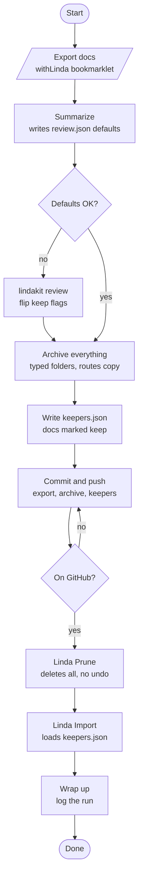

# RepoMan Workflow

A complete walkthrough of the context cleanup process, from a bloated
Project to a lean, curated context window. Nothing is lost along the way:
every doc is archived and committed before anything is deleted.

---

## The problem

Claude Projects accumulate docs over time. Every handoff, design note and
scratch file from months of work sits in the context window and costs tokens
in every session. Most of it is obsolete.

The fix is a periodic cleanup: export everything, archive everything,
decide what stays, prune the Project, and re-import only the keepers.

---

## The flow



Two ideas drive the shape:

- **Review is optional.** Summarize always produces a `review.json` with a
  default decision for every doc, so the whole pipeline can run with no human
  input. Review is just a chance to edit those defaults.
- **Everything is archived first.** Prune deletes every doc from the Project
  anyway, so the only real decision is which docs come back. A doc is either a
  keeper or archive-only. There is no "delete" outcome, because nothing is
  thrown away.

---

## Status: what works today

The flow above is the target. Not every step is built.

| Step | Tool | Status |
|---|---|---|
| Export | withLinda bookmarklet | external, works |
| Summarize | `lindakit export` | prints a summary; does **not** yet write `review.json` |
| Review | `lindakit review` | implemented; interactive, resumable |
| Archive everything | `lindakit archive` | partial: writes only docs marked archive, no dedupe, no filename flattening |
| Keepers | `lindakit keepers` | implemented |
| Commit and push | git, by hand | manual |
| Prune | Linda Prune bookmarklet | implemented |
| Import | Linda Import bookmarklet | implemented |
| Wrap up | by hand | manual; routes are planned |

Planned work and known bugs are tracked in `docs/roadmap.md`. Until the
planned pieces exist, do the missing steps by hand: run `lindakit review`
to produce `review.json`, then archive and commit the raw export alongside it
(see below), which makes the manual path equally safe.

---

## Filesystem convention

All context lifecycle files live under `docs/context/` in the project repo.
Commit all of it.

```
docs/context/
  lindakit.yaml        per-repo settings (types, defaults, routes)
  review.json          decisions: auto-generated defaults, editable
  keepers.json         what gets re-imported
  exports/             raw withLinda exports, one per run
    2026-11-06.json
  archive/             every doc from the export, keepers too
    handoffs/
    design/
    reference/
    research/
    ...                one folder per doc type
```

Why commit everything: the raw export is the lossless record. It carries each
doc's `uuid` and `created_at`, which the archived `.md` files do not. Archive
files are the readable, sorted view. Disk is cheap and a lost doc is not.

Docs are sorted into `archive/<type>/` by their name prefix; see
`docs/naming-conventions.md`.

---

## Step 1: Export

On your Claude Project page, run the **withLinda** bookmarklet. Save the
downloaded JSON as `docs/context/exports/YYYY-MM-DD.json`.

## Step 2: Summarize

```bash
lindakit export docs/context/exports/2026-11-06.json
```

Prints each doc's name, detected type, size and flags (stale handoff,
duplicate). Once the planned change lands, this step also writes
`docs/context/review.json`, giving each doc a default decision from the
type rules in `lindakit.yaml`:

- reference and recent handoff docs default to **keep**
- everything else defaults to **archive**
- nothing defaults to delete

Docs with identical content (after stripping a `claude/` name prefix) are
treated as one.

## Step 3: Review (optional)

```bash
lindakit review docs/context/exports/2026-11-06.json -o docs/context/review.json
```

Walks each doc and asks keep, archive, delete or skip. Decisions are saved
after every answer, so you can quit and resume. A human decision always
overrides the default.

## Step 4: Archive everything

```bash
lindakit archive docs/context/review.json -d docs/context/archive/
```

Writes every doc into `archive/<type>/`, keepers included, so the repo holds
a complete copy of the Project. Archived docs of a routed type are also copied
to their destination in the repo (for example design docs to `docs/roadmap/`).
Routing copies; it never moves.

## Step 5: Write keepers.json

```bash
lindakit keepers docs/context/review.json -o docs/context/keepers.json
```

Writes the JSON array of docs marked keep. This is the file Linda Import
reads.

## Step 6: Commit and push

Commit the raw export, `review.json`, `keepers.json`, `lindakit.yaml` and the
archive, then push. **Confirm the commit is on GitHub before going on.** Prune
is the one step that cannot be undone, and this is the gate in front of it.

## Step 7: Prune

On the Project page, click **Linda Prune**. It deletes every doc in the
Project. There is no undo, which is why step 6 comes first.

## Step 8: Import

Click **Linda Import** and select `docs/context/keepers.json`. The Project now
holds exactly the docs you chose.

## Step 9: Wrap up

Record the run (see `docs/seanchai-cleanup-run.md` for the format). Check that
any routed copies, such as design docs under `docs/roadmap/`, are committed.

---

## Restoring an archived doc

Archived files keep their prefixed names, so restoring one is a copy: put the
file in a `keepers.json`-shaped list and run Linda Import. It returns to the
Project already named correctly.

---

## Shortcut

**Linda Refresh** combines Prune and Import in one bookmarklet. Use it when
the archive is committed and pushed and `keepers.json` is ready.

---

## Suggested cadence

- **Monthly**: anything older than a month that is not an evergreen reference
  probably does not need to be in context.
- **After a major feature**: once a changedoc has shipped, it goes to the
  archive, not the context.
- **When context feels bloated**: `lindakit export` shows the footprint
  immediately.
